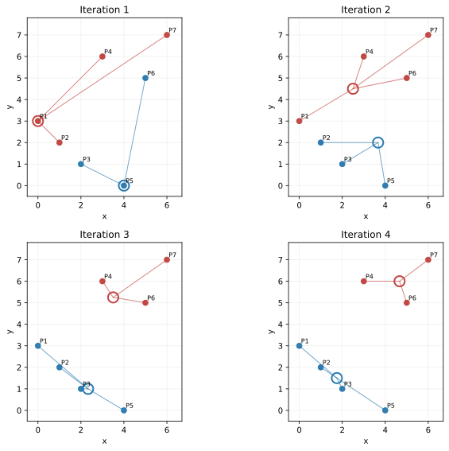

# Smart Infrastructure · 提纲

## 1. Week 1

### 1.1 什么是smart infrastructure？

- **Level:** Decision-making based on sensor data is autonomous and near real time.

- **Values:**
    - Self-monitoring and accuracy in decision-making.
    - Efficiency and cost savings.
    - Reliability.
    - Security, safety and resilience.
    - User interaction and empowerment.
    - Sustainability.
    - Redundancy minimisation.
    - Response time.
    - Low carbon footprint.
    - Service quality.

| 维度 | 具体体现 |
|---|---|
| 运营效率 | 自我监测与精准决策；提升效率并降低成本；减少冗余。 |
| 安全性与可靠性 | 增强系统的可靠性、安全性与韧性；缩短响应时间。 |
| 用户与社会 | 赋能用户并增强交互；提升服务质量。 |
| 环境可持续性 | 实现低碳足迹；促进能源与资源的可持续利用。 |

**Principles**

- **Acquire data**.

- **Analyse data (real time)**.

- **Maintain feedback loop**.

- **Design for adaptability**.

### 1.2 Interrogate data的过程，Data analytics-based smart infrastructure process

**1.2.1 Consider the data analytics-based process for smart infrastructure. At which point does the process end? Explain the process and support the explanation by an example of smart infrastructure value creation.**


There is no true end, it is a cycle.

Example: Smart Street Lighting

1. **Business Understanding**

    What is the problem that I want to solve?

    The goal is to reduce city electricity costs.

2. **Analytics Approach**

    How can I use data to answer Question 1？

    Dim the street lamps when the street is empty.

3. **Data Requirements**

    What data do I need for Question 2?

    Need data on Number of cars and people on the street at different times

4. **Data Collection**

    Where is this data produced, how I can get it?

    Put sensors on the lamps.

5. **Data Understanding**

    Is the data that I collected representative of the problem that want to solve?

    Check: Is the data real?（Is it a person or a cat?）

6. **Data Preparation**

    Is the data ready to be used or do I need to ‘clean’ it first?

    Remove "bad" data and fix errors.

7. **Modelling**

    How can I visualize the data to answer my question?

    Create a plan: 100% light if busy, 50% if quiet.

8. **Evaluation**

    Does my model answer the question or do I need to change it?

    How much electricity consumption was reduced?

9. **Deployment**

    Can the model be used in practice?

    Use this system in the whole city.

10. **Feedback**

    Can I get feedback and new data on how well I’ve answered the initial question?

    Check the bills. Ask people: "Is it good?"

### 1.3 反馈过程理解

**问题：** Consider the data analytics-based process for smart infrastructure shown above. Explain the loop between feedback and modelling using an example from transport, energy, healthcare or climate.（最多 200 词）

Example: Smart Traffic Management

1.  Modelling: Create a prediction model using traffic data (vehicle counts, speed, time patterns) to forecast congestion and optimize traffic light timing.

2.  Evaluation: Test if the model accurately predicts traffic flow.

3.  Deployment: Install the model in real traffic control systems across the city.

4.  Feedback: Collect real-world performance data:

    - Actual traffic speeds

    - Congestion levels

    - Travel times

    - Driver behavior

5.  Back to Modelling: Use feedback to improve the model:

    - Fix errors (model underestimated rush hour traffic)

    - Add new factors (construction zones, weather impacts)

    - Update parameters with recent patterns

6.  Repeat: Deploy improved model → Get new feedback → Refine further

**The Loop's Value:**

- Models learn from real outcomes, not just historical data

- System adapts to changing conditions (new roads, population growth)

- Continuous optimization improves traffic flow over time

- Identifies blind spots in original assumptions

**1.3.1 A smart car uses computer vision to predict if a pedestrian will cross the street in front of it (positive class) or not (negative class). If crossing is predicted, the car will automatically stop. A dataset of 300 video clips is manually labelled where each video clip constitutes a data point. 250 of those in which pedestrians cross the street are labelled as positive, the rest are negative.**

| Predicted class / Actual class | Positive | Negative |
|---|---|---|
| Positive | TP | FP |
| Negative | FN | TN |

```math
\mathrm{Sensitivity}=\mathrm{Recall}=\mathrm{TPR}=\frac{TP}{TP+FN}
```

```math
\mathrm{Specificity}=\mathrm{TNR}=\frac{TN}{FP+TN},\qquad \mathrm{Precision}=\mathrm{PPV}=\frac{TP}{TP+FP}
```

```math
F_1=\frac{2\,\mathrm{Precision}\,\mathrm{Recall}}{\mathrm{Precision}+\mathrm{Recall}}
```

**1.3.2 Model A correctly predicts all positive cases and achieves 83.33% accuracy. Evaluate this model and discuss how its performance will affect the car behaviour. Use the metrics in Appendix A to support your argument.**

| Actual / Predicted | Positive | Negative | Total |
|---|---:|---:|---:|
| Positive | 250 | 0 | 250 |
| Negative | 50 | 0 | 50 |
| Total | 300 | 0 | 300 |

1. **安全性角度：** 这份测试集上的召回率很高 —— 因为 FN=0，测试集中真正横穿的行人都被检出。

    - **Safety on this test set:** Recall = 100%.

    - **FN = 0:** The model misses none of the crossing pedestrians in the test set.

    - **Result:** It predicts crossing for every clip and always requests a stop. Test results alone do not establish safety in every real-world situation.

2. **体验/交通角度：** 很糟 —— 因为 FP=50 且 Specificity=0，表示只要遇到行人就几乎都判“会横穿”并停车：

    - **Traffic & Experience:** Very Bad

    - **FP = 50 / Specificity = 0:** The car is too "scared."

    - **Result:** It stops for every person on the sidewalk in the test, even if they aren't crossing. It Sacrifices traffic efficiency for safety.

**1.3.3 Model B correctly predicts all negative cases and achieves 83.33% accuracy. Evaluate this model and discuss how its performance will affect the car behaviour. Use the metrics in Appendix A to support your argument.**

| Actual / Predicted | Positive | Negative | Total |
|---|---:|---:|---:|
| Positive | 200 | 50 | 250 |
| Negative | 0 | 50 | 50 |
| Total | 200 | 100 | 300 |

1. **体验/效率角度：** 这份测试集上没有误报 —— FP=0，没有因误判横穿而触发停车；这不能说明模型的预测置信度。

    - **Traffic & Efficiency:** Excellent

    - **FP = 0:** Zero "false alarms."

    - **Result:** No stop is triggered for a non-crossing pedestrian in this test set.

2. **Safety:** Very Dangerous

    - **FN = 50:** The car missed 50 people who actually crossed.

    - **Result:** The car failed to stop many times when it should have, leading to high accident risks.

两种模型的指标汇总：

| Metric | Model A | Model B |
|---|---:|---:|
| Accuracy | 83.33% | 83.33% |
| Recall / Sensitivity | 100% | 80% |
| Specificity | 0% | 100% |
| Precision | 83.33% | 100% |
| F1 | 90.91% | 88.89% |

#### 1.3.4 What can you do to have a better model than A and B? Hint: Consider the process in Figure 1 and identify the steps that you might use to improve your model.

1. **Data Collection**

    The goal is to ensure high-quality inputs for the model.

    - **Class Balance:**

      - Augment negative samples to balance the classes.

      - For training, choose an appropriate balance between crossing and non-crossing clips. The labels describe whether pedestrians cross, not simply whether pedestrians are present. Keep validation and test sets representative of the intended operating conditions.

    - **Data Diversity:**

      - Collect data that covers varied conditions (e.g., different weather, times of day, and pedestrian behaviors).

      - This helps reduce overfitting to limited data scenarios.

    - **Data Cleaning:**

      - Remove low-quality data.

      - Correct **mislabels** to ensure data reliability.

2. **Modelling**

    The focus here is on configuring the model for safety and accuracy.

    - **Loss Function:**

      - Prioritize safety by using a **weighted loss function** (likely penalizing missed detections more heavily).

    - **Hyperparameter Tuning:**

      - Optimize parameters to find the right balance between **recall and precision**.

    - **Validation:**

      - Split data into different sets (Training vs. Validation vs. Test) to ensure unbiased evaluation.

    - **Algorithm Selection:**

      - Choose an appropriate algorithm with strong computer vision capabilities.

      - Ensure the algorithm captures **movement features** well.

3. **Evaluation**

    Look beyond Accuracy. Do not just check the total score. Focus more on False Negatives (missing a person) and True Positives (correctly stopping) to ensure safety.

4. **Deployment & Feedback Loop**

    How to maintain the model after it goes live.

    - **Deploy a Feedback Loop:**

      - After the initial deployment, collect real-world data.

      - **Retrain** the model periodically using this new data.

    - **False Negative (FN) Management:**

      - Specifically identify occasional False Negatives (cases where the model missed something) and add them back into the **training set** to improve future performance.

### 1.4 电费题

**问题：** A smart grid uses machine learning to detect energy theft（positive class）or no theft（negative class）. When theft is detected, an engineer visits the address to confirm it, at a cost. Undetected theft causes unbilled energy consumption and lost revenue. The dataset contains 90% no-theft samples and 10% theft samples.

1. Would you collect data every second, minute, hour or day? Justify your answer.（最多 100 词）
2. Would you prioritise correct prediction of the positive or negative class? Why?（最多 100 词）
3. Use the model results below to choose the best method. WF1 is weighted F1 score; TPR is True Positive Rate; * denotes data augmentation for rebalancing.（最多 100 词）


1. **Recommendation:** Hourly data collection

    Hourly collection is best.

    - **Daily data** is too slow to catch theft quickly and misses important patterns.
    - **Minute or second data** costs too much storage and processing power without helping much.
    - **Hourly data** captures daily usage patterns well, supports timely detection and investigation, keeps costs reasonable, and works well for machine learning models.

2. **Prioritise:** Positive class (theft detection)

    Detecting theft is more important.

    - **False negative:** Missing real theft causes direct money loss from unbilled energy.
    - **False positive:** False alarms only waste investigation time but can be managed.
    - **Class imbalance:** With 90% no-theft samples, models might just predict "no theft" for everything and miss all thieves.
    - **Metric:** We need high recall/TPR to catch actual theft cases.

3. **Best model:** RUSBoost\* (after data augmentation)

    RUSBoost\* has the highest TPR (55%) and a WF1 of about 77%, so it is preferred if catching theft is the main priority. LGBM and CNN have higher WF1 but lower TPR (about 20% and 35%); the other models achieve roughly 42%–52% TPR. RUSBoost\* catches more theft cases, although false-positive rates and investigation costs are also needed to judge the overall trade-off. The \* denotes data augmentation for rebalancing.

注：F1的取值范围是\[0, 1\]，F1 = 1 时，意味着模型的 Precision（精确率） 和 Recall（召回率） 同时也都达到了 1。当 F1 = 0 时，意味着 Precision 或 Recall 中至少有一个为 0。

### 1.5 Analytics

| Analytics | Question | Tools | Applications |
|---|---|---|---|
| Descriptive | What happened? | Data aggregation; data clustering | Demand response; customer classification |
| Diagnostic | Why is it happening? | Correlation; cause–effect analysis | Fault diagnosis; customer decisions |
| Predictive | What will happen? | Statistical methods; forecasting techniques | Load/generation forecasts; predictive dispatch/control |
| Prescriptive | What should we do? | Probabilistic/stochastic tools; heuristics | Resource planning strategies; decision-making under uncertainty |

从 Descriptive 到 Prescriptive，分析的复杂程度与可支持的决策价值逐步增加。

- **Descriptive Analytics**

    What happened

- **Diagnostic Analytics**

    Why happening

- **Predictive Analytics**

    What will happen

- **Prescriptive Analytics**

    What to do

### 1.6 Smart grids

**Smart grids represent a leading application to smart infrastructure and aim to improve the efficiency, resilience, and sustainability of energy systems. This question examines the peak-shaving feature of smart grids shown in Figure 6 to avoid the inefficient and costly energy production during peaks.**

#### 1.6.1 What data would you need to investigate this solution and which sensors and/or other data sources would you need? (less than 100 words)


1. need real-time energy consumption profiles to identify peak timings.

2. **Smart Meters:** For granular household usage data.

3. **Smart Appliances/IoT Sensors:** To monitor individual device consumption.

4. **Weather Data:** To forecast renewable generation (wind/solar) and heating demand.

5. **SCADA/PMUs:** For grid operational monitoring.

    **SCADA（Supervisory Control and Data Acquisition，数据采集与监视控制系统）**

    - 由计算机、网络和传感器组成，用于实时监控和控制基础设施，是电网运行的基础数据来源。
    - 采集变电站的电压、电流、开关状态等数据。
    - 监视与报警：控制中心显示电网状态，出现跳闸等故障时报警。
    - 控制：操作员可以远程发出打开或关闭断路器等指令。

    **PMU（Phasor Measurement Unit，相量测量单元）**

    - 是广域测量系统 WAMS 的重要组件，监测电网动态状态。
    - 与按秒级更新的传统 SCADA 相比，PMU 常以每秒数十次的速率报告同步相量，例如每秒 30–60 次，有助于捕捉振荡等快速变化。
    - 利用 GPS 等统一时间源给测量值加时间戳，使不同位置的数据能够按时间对齐。
    - 用于评估电压、频率及动态稳定性，帮助发现可能导致大范围停电的异常。

**1.6.1.1 What type of analytics would you need to investigate the efficacy of the solution under different scenarios? Can you think of an artificial intelligence approach to generate these**

1. I would use Predictive Analytics to show what will happen to the grid load under various conditions, and Prescriptive Analytics to show what to do by optimizing strategies to shave the peaks.

2. **AI Approach:** "I would use GANs. They learn from past data to create realistic test scenarios. This helps us simulate extreme events to verify 'resource plan strategies' and make 'decisions under uncertainty' without real-world risks."

**1.6.1.2 The data in Figure 7 shows that less than 50% of residential homes in the United Kingdom upgraded to smart meters despite the evidence that these can contribute to sustainable energy production and reduce the energy bills of homes by up to 10%. What could be the reason and how would you apply data analytics to investigate. Hint: think of data privacy and related risks. (max 200 words)**

**Figure 7 — Smart meter adoption in the United Kingdom（Statista, 2021）**

| Region | Adoption rate |
|---|---:|
| North East | 56% |
| North West | 53% |
| West Midlands | 53% |
| Wales | 52% |
| South West | 52% |
| East Midlands | 47% |
| East of England | 47% |
| Yorkshire and the Humber | 47% |
| London | 43% |
| South East | 41% |
| Scotland | 40% |
| Northern Ireland | 24% |

1. The main reason is that people are worried about their privacy and online safety. Smart meters collect very detailed data about electricity use, like when someone is not at home. This makes people feel uncomfortable, as they fear being watched, having their data used in the wrong way, or being hacked.

2. First, I would use Descriptive Analytics to look at customer feedback and social media comments. This helps me find out what is happening — for example, many people often mention "privacy" as a big concern.

3. Next, I would use Diagnostic Analytics to find out why this is happening. I would use Correlation tools to check if people who care more about privacy are also the ones rejecting smart meters. A clear connection supports this explanation, but correlation alone does not establish that privacy fears cause low usage; surveys and other factors such as cost and installation access should also be examined.

## 2. Week 2

### 2.1 Data fusion


1. **Heterogeneous Input Data**

    Diverse data from different sources

2. **Data Alignment**

3. **Data/Object Correlation**

4. **Aligned and Correlated Data**

5. **Attribute/Identity Estimation**

6. **Data Fusion Result**

### 2.2 看图回答


**Figure 4 — Human error and road accidents（题目给定数据）**

| Human error / protective measure | Analysis |
|---|---|
| Speeding | Every 1% increase in mean speed produces a 4% increase in fatal crash risk and a 3% increase in serious crash risk. |
| Drunk driving | Accounts for 10% of road fatalities in the supplied material. |
| Helmet | Correct use can reduce the risk of death in a crash by more than six times, and the risk of brain injury by 74%. |
| Seat belt | Wearing one can reduce the risk of death among vehicle occupants by up to 50%. |
| Child restraint | Can reduce deaths among infants by 71%. |
| Mobile phones, including hands-free | Drivers using phones are approximately four times more likely to be involved in a crash. |

据此回答下面三个问题：选择要解决的事故成因及 Smart Transportation 技术；说明传感器和评价方法；选择分析方法并讨论 Digital Twins。

#### 2.2.1 想解决哪些事故成因？用哪些 Smart Transportation 技术？（≤100词）

**Vehicle-to-Everything（V2X）包括四类通信：**

- Vehicle-to-Vehicle（V2V）：车辆与车辆。
- Vehicle-to-Infrastructure（V2I）：车辆与道路基础设施。
- Vehicle-to-Network（V2N）：车辆与网络。
- Vehicle-to-Pedestrian（V2P）：车辆与行人。

- I would address accidents caused by driver error（Driver failed to look properly）, using ITS（Intelligent Transportation Systems）to reduce human mistakes.

- Collaborative Perception and V2X (Vehicle-to-Everything) techniques

- These systems let cars share information. They include features like Blind Spot Assist and Collision Avoidance.

#### 2.2.2 您将使用什么类型的传感器来收集数据以支持您的解决方案？您将如何评估您的解决方案？（最多 100 字）。

**交通数据的三类来源：**

- Road sensors：道路传感器，构成 Smart Infrastructure。
- Vehicle-mounted sensors：车载传感器，构成 Smart Vehicles。
- Sensors carried by Vulnerable Road Users（VRUs）：行人、骑行者等携带的手机或可穿戴传感器。


**Disruptive sensors：** 安装或嵌入道路表面，对路面造成施工影响。

| Sensor | Detection capabilities |
|---|---|
| Road-embedded sensor | Vehicle count; speed; direction |
| Road-surface dome sensor | Vehicle count; speed; direction; real-time information for traffic-light control |
| Inductive loop detector | Vehicle count; speed; direction; vehicle type |

**Non-disruptive sensors：** 安装在道路外部，无需改变路面结构。

| Sensor | Detection capabilities |
|---|---|
| Pole-mounted sensor | Vehicle count; speed; direction; real-time information for traffic-light control |
| Traffic-monitoring camera system | Vehicle count; speed; direction; vehicle type |
| Video-surveillance camera | 从视频中提取车辆与道路状态等多类信息 |


**LiDAR 与 Radar 的典型比较：**

| 特性 | LiDAR（激光雷达） | Radar（雷达） |
|---|---|---|
| 工作原理 | 发射激光束，通过回波测距 | 发射无线电波，通过回波测距；多普勒效应可用于测速 |
| 空间分辨率 | 通常较高，可形成较精细的三维轮廓 | 通常较低，目标轮廓较粗略 |
| 天气影响 | 雨、雪、浓雾中的光散射可能降低性能 | 通常对雨雾和尘埃更稳健 |
| 典型探测距离 | 课件以约 200 m 为例 | 课件以 250 m 以上为例 |
| 测速能力 | 可通过连续测量估计速度 | 可直接利用多普勒信息测速 |
| 成本 | 课件中的方案相对较高 | 课件中的方案相对较低 |

具体量程、分辨率与成本取决于器件和工作条件。

- **Vehicle mounted sensors**

    - use **Camera sensors** to identify objects and signs, and use **Radar sensors** for detection

- **Evaluation**

    - use **Vehicle accident frequency（before VS after）** to do the evaluation.

#### 2.2.3 您将应用什么类型的分析来分析提议解决方案的有效性？在这种情况下，您会考虑使用数字孪生 (Digital Twins) 吗？（最多 100 字）。

- I would use Descriptive Analytics to show what happened and Diagnostic Analytics to show why happening.

- I would use Predictive Analytics to show what will happen and Prescriptive Analytics to show what to do.

- Yes, Integrating Digital Twins enables higher-level Predictive and Prescriptive Analytics. This allows us to simulate "what will happen" under different scenarios and optimize "resource plan strategies" (what to do) in a virtual environment before actual implementation, ensuring maximum efficacy with minimal risk.

### 2.3 汽车尾气


**根据上方 LEZ/ULEZ、交通量与 PM2.5 图表回答：**

1. Investigate whether LEZ/ULEZ affected PM2.5 levels. What type of data analytics would you use, and what is your initial finding? Justify it using the supplied data.（最多 100 词）
2. What sensors would you use to monitor vehicle types on the road?（最多 100 词）
3. During the COVID pandemic, the UK imposed mobility restrictions. How is this reflected in the data, and how does it affect the analysis? What analytical treatment would you use for that period?（最多 100 词）

1. **Diagnostic Analytics**

    The initial finding shows PM2.5 decreased significantly. Central roadside dropped from 16.4 μg/m³ (2017) to 10.0 μg/m³ (2023) - a 39% reduction. Inner London roadside fell 41%. The data also shows traffic volume declined in Central and Inner London after the zones started, which is consistent with a possible ULEZ effect, but does not by itself establish causation.

2. To effectively monitor vehicle types, I would deploy a combination of disruptive and non-disruptive sensors:

    - **Disruptive Sensors:** I would use Inductive Loop Detectors. Unlike other road-embedded options, these specifically list "vehicle type identification" as a capability alongside speed and counting.

    - **Non-Disruptive Sensors:** I would implement Traffic Monitoring Camera Systems or Video Surveillance Cameras. These are crucial because they can visually distinguish specific vehicle classes (e.g., distinguishing a van from a car) and extract detailed information from video footage without damaging the road surface.

3. **COVID is reflected in the 2020-2021 data:** PM2.5 dropped sharply (to 8.8 μg/m³) and traffic collapsed (Figure 4). This confounds my analysis in (i) because lockdowns also reduced travel and emissions, so the change cannot be attributed solely to ULEZ.

    - **Strategy:** Utilize Predictive Analytics.

    - **Process:** Perform Data Preparation (Data cleaning).

    Mark the lockdown periods and account for them in the analysis, for example with a lockdown indicator, traffic and weather controls, or a comparison with unaffected areas. Compare results with and without those periods as a sensitivity check.

    Lockdown observations are real data; removing them automatically does not by itself remove confounding.

**A smart car uses computer vision to predict if the driver is distracted (positive class) or not (negative class). If the model identifies the driver as distracted, it will generate an alarm and force the car to stop. The test dataset of 300 video clips is manually labelled where each video clip constitutes a data point. 50 of those in which the driver is distracted are labelled as positive, 250 are negative.**

**Figure 5 — Confusion matrices of Models A and B**

| Model | Actual class | Predicted distracted（T） | Predicted not distracted（N） |
|---|---|---:|---:|
| A | Distracted（T） | 10 | 40 |
| A | Not distracted（N） | 10 | 240 |
| B | Distracted（T） | 45 | 5 |
| B | Not distracted（N） | 50 | 200 |

比较两个模型，选择更适合的一个；再讨论类别不平衡时如何提高性能，以及需要补充的数据和传感器。

#### 2.3.1 哪个模型更合适？为什么？

1. Model B is better.

2. **Key metrics**

    | Metric | Model A | Model B |
    |---|---:|---:|
    | Accuracy | (10 + 240) / 300 ≈ 0.83 | (45 + 200) / 300 ≈ 0.82 |
    | Recall | 10 / 50 = 0.20 | 45 / 50 = 0.90 |
    | Missed distracted drivers（FN） | 40 | 5 |
    | False alarms（FP） | 10 | 50 |

    Model B catches 90% of distracted drivers, at the cost of more false alarms.

3. In safety-critical tasks, it is better to have a false alarm than to miss a danger. Model B captures the "distracted" drivers much better.

#### 2.3.2 数据不平衡时如何提升性能？还需要什么数据？传感器？

- Use Oversampling on the minority class (distracted) or Undersampling on the majority class to balance the training set.

- **Eye Movement**

    Sensor: Infrared (IR) eye-tracking camera. 红外

- **Heart Rate**

    Wearable sensors (smartwatch) or contact sensors on the steering wheel（方向盘）.

### 2.4 混淆矩阵

**问题背景：** An eHealth phone application uses wearable sensors and machine learning to detect potential heart attacks. A positive classification dispatches an ambulance, even if incorrect; an incorrect negative classification leaves a patient at risk without assistance. The test set has 300 manually labelled ECG samples, each covering a fixed duration.

**Figure 7 — Confusion matrices of Models A and B**

| Model | Ground truth | Predicted positive（T） | Predicted negative（N） |
|---|---|---:|---:|
| A | Positive（T） | 140 | 10 |
| A | Negative（N） | 100 | 50 |
| B | Positive（T） | 120 | 30 |
| B | Negative（N） | 50 | 100 |

1. Which model is more suitable? Justify your answer.
2. Discuss possible causes of incorrect predictions.
3. Samples come from 10 subjects aged 18–90. Would you recommend 5-fold validation or Leave One Subject Out（LOSO）validation? Explain.

- Model A is better.

    **Key metrics**

    | Metric | Model A | Model B |
    |---|---:|---:|
    | True Positive（TP） | 140 | 120 |
    | False Negative（FN） | 10 | 30 |
    | False Positive（FP） | 100 | 50 |
    | True Negative（TN） | 50 | 100 |
    | Recall | 140 / 150 ≈ 93.3% | 120 / 150 = 80% |

    **Reasons:**

    - False Negative = patient has heart attack but gets no help → life-threatening

    - False Positive = unnecessary ambulance → consumes resources and may delay care for other patients

    - Model A has fewer false negatives (10 vs 30)

    - For this question, prioritize fewer missed heart attacks, while also considering ambulance capacity and the cost of false alarms.

- **影响模型表现的因素**

    - Sensor noise and signal interference

    - Individual differences in ECG patterns

    - Motion artifacts from daily activities

    - Imbalanced training data

    - Poor feature extraction

    - Overfitting or underfitting

- **LOSO validation**

    - **Prevention of Data Leakage:** ECG data is highly subject-specific. Standard 5-fold validation randomly mixes samples, likely placing data from the same subject in both training and testing sets. This allows the model to "memorize" individual features rather than learning general disease patterns, leading to inflated accuracy.

    - **Assessment of Generalization:** Real-world applications encounter unseen users. LOSO (training on 9 subjects, testing on 1) tests an unseen-subject scenario, helping assess whether the model generalizes beyond the people in the training set.

    - **Practicality:** With only 10 subjects, LOSO is quick to run. It provides a more relevant evaluation than randomly splitting clips across the same subjects. Grouped 5-fold validation with whole subjects assigned to folds is also a valid alternative; either approach must keep subjects separate.

### 2.5 计算Z-score


- **正常范围 (Not unusual):** $`-2\le z\le2`$。
- **中度异常 (Moderately unusual):** $`-3\lt z\lt -2`$ 或 $`2\lt z\lt 3`$。
- **异常值 (Outliers):** $`z\le-3`$ 或 $`z\ge3`$。

```math
z=\frac{x-\mu}{\sigma}.
```

**例题数据：** 26, 37, 24, 28, 35, 22, 31, 53, 41, 64, 29。

求均值、总体标准差，以及各观测值的 Z-score。

**计算均值：**

```math
\bar x=\frac{\sum_{i=1}^{n}x_i}{n}=\frac{390}{11}\approx35.4545.
```

**计算总体标准差：**

```math
\sigma=\sqrt{\frac{\sum_{i=1}^{n}(x_i-\bar x)^2}{n}}.
```

- 对每个观测值计算与均值的差，再平方求和：$`\sum (x_i-\bar x)^2\approx1674.7273`$。
- 总体方差：$`\sigma^2=1674.7273/11\approx152.2479`$。
- 总体标准差：$`\sigma\approx12.339`$。
- 如果计算样本标准差，分母应使用 $`n-1`$；本题使用总体标准差。

**计算 Z-score：** $`z=(x-\bar x)/\sigma`$，代入未舍入的均值与标准差。

| x | Z-score（保留三位小数） |
|---:|---:|
| 26 | -0.766 |
| 37 | 0.125 |
| 24 | -0.928 |
| 28 | -0.604 |
| 35 | -0.037 |
| 22 | -1.090 |
| 31 | -0.361 |
| 53 | 1.422 |
| 41 | 0.449 |
| 64 | 2.313 |
| 29 | -0.523 |

### 2.6 计算IQR

```math
IQR=Q_3-Q_1.
```

```math
\text{Lower fence}=Q_1-1.5\,IQR.
```

```math
\text{Upper fence}=Q_3+1.5\,IQR.
```


继续使用上题数据，排序后为：22, 24, 26, 28, 29, 31, 35, 37, 41, 53, 64。

1. **Median = 31**：11 个观测值的第 6 个。
2. **Q1 = 26**：不计总体中位数，下半部分 22, 24, 26, 28, 29 的中位数。
3. **Q3 = 41**：上半部分 35, 37, 41, 53, 64 的中位数。

4. **IQR：** $`41-26=15`$。
5. **下界：** $`26-1.5\times15=3.5`$；**上界：** $`41+1.5\times15=63.5`$。
6. **异常值：** 只有 64 大于 63.5；没有数据小于 3.5。


## 3. Week 3

**3.1 Smart meters in the UK can be programmed by the customer to report data every 15 minutes or 30 minutes. How would you prepare the data from multiple smart meters with different setting before applying a data analytics approach? Hint: there are two options, discuss both. (less than 150 words)**

1. **Downsampling (Aggregation)：** Convert 15-minute data into 30-minute intervals, usually by summing (for energy) or averaging (for power) every two readings.

    **Pros:**

    - Uses only actual recorded data

    - High accuracy and less noise

    **Cons:**

    - Lower resolution

    - May miss short-term peaks important for some analyses

2. **Upsampling (Interpolation)：** Convert 30-minute data into 15-minute intervals. For interval energy totals, allocate each total across the two shorter intervals while preserving its sum; for sampled power values, linear interpolation may be used.

    **Pros:**

    - Preserves the existing 15-minute readings and puts all meters on a common time grid

    - Allows modeling at 15-minute intervals, but does not recover the missing detail in 30-minute readings

    **Cons:**

    - Introduces estimated ("synthetic") data

    - Might make the data look too smooth and hide real changes

3. **Summary**

    - Use Option 1 for accurate reporting and reliability.

    - Choose Option 2 if you need detailed pattern analysis and can accept some estimation error.

### 3.2 K means

数据点为：

| Point | P1 | P2 | P3 | P4 | P5 | P6 | P7 |
|---|---:|---:|---:|---:|---:|---:|---:|
| x | 0 | 1 | 2 | 3 | 4 | 5 | 6 |
| y | 3 | 2 | 1 | 6 | 0 | 5 | 7 |

取初始质心 $`C_{1,1}=(0,3)`$、$`C_{2,1}=(4,0)`$。

```math
D(P_1,P_2)=\sqrt{(x_1-x_2)^2+(y_1-y_2)^2}.
```

每轮先按欧氏距离分配，再用簇内坐标均值更新质心。表中列出距离的平方，距离本身为对应值的平方根；这不影响最近质心的判断。数值展示保留四位小数，计算使用未舍入值。

1. **Iteration 1**：$`C_1=(0,3)`$，$`C_2=(4,0)`$。

    | 距离平方 / Point | P1 | P2 | P3 | P4 | P5 | P6 | P7 |
    |---|---:|---:|---:|---:|---:|---:|---:|
    | $`D^2(C_1,P)`$ | 0.0000 | 2.0000 | 8.0000 | 18.0000 | 25.0000 | 29.0000 | 52.0000 |
    | $`D^2(C_2,P)`$ | 25.0000 | 13.0000 | 5.0000 | 37.0000 | 0.0000 | 26.0000 | 53.0000 |
    | 归属 | C1 | C1 | C2 | C1 | C2 | C2 | C1 |

    - $`C_1`$ 包含 P1, P2, P4, P7；更新为 $`((0+1+3+6)/4,(3+2+6+7)/4)=(2.5,4.5)`$。

    - $`C_2`$ 包含 P3, P5, P6；更新为 $`((2+4+5)/3,(1+0+5)/3)=(3.66667,2)`$。

2. **Iteration 2**：$`C_1=(2.5,4.5)`$，$`C_2=(3.66667,2)`$。

    | 距离平方 / Point | P1 | P2 | P3 | P4 | P5 | P6 | P7 |
    |---|---:|---:|---:|---:|---:|---:|---:|
    | $`D^2(C_1,P)`$ | 8.5000 | 8.5000 | 12.5000 | 2.5000 | 22.5000 | 6.5000 | 18.5000 |
    | $`D^2(C_2,P)`$ | 14.4444 | 7.1111 | 3.7778 | 16.4444 | 4.1111 | 10.7778 | 30.4444 |
    | 归属 | C1 | C2 | C2 | C1 | C2 | C1 | C1 |

    - $`C_1`$ 包含 P1, P4, P6, P7；更新为 $`((0+3+5+6)/4,(3+6+5+7)/4)=(3.5,5.25)`$。

    - $`C_2`$ 包含 P2, P3, P5；更新为 $`((1+2+4)/3,(2+1+0)/3)=(2.33333,1)`$。

3. **Iteration 3**：$`C_1=(3.5,5.25)`$，$`C_2=(2.33333,1)`$。

    | 距离平方 / Point | P1 | P2 | P3 | P4 | P5 | P6 | P7 |
    |---|---:|---:|---:|---:|---:|---:|---:|
    | $`D^2(C_1,P)`$ | 17.3125 | 16.8125 | 20.3125 | 0.8125 | 27.8125 | 2.3125 | 9.3125 |
    | $`D^2(C_2,P)`$ | 9.4444 | 2.7778 | 0.1111 | 25.4444 | 3.7778 | 23.1111 | 49.4444 |
    | 归属 | C2 | C2 | C2 | C1 | C2 | C1 | C1 |

    - $`C_1`$ 包含 P4, P6, P7；更新为 $`((3+5+6)/3,(6+5+7)/3)=(4.66667,6)`$。

    - $`C_2`$ 包含 P1, P2, P3, P5；更新为 $`((0+1+2+4)/4,(3+2+1+0)/4)=(1.75,1.5)`$。

4. **Iteration 4**：$`C_1=(4.66667,6)`$，$`C_2=(1.75,1.5)`$。

    | 距离平方 / Point | P1 | P2 | P3 | P4 | P5 | P6 | P7 |
    |---|---:|---:|---:|---:|---:|---:|---:|
    | $`D^2(C_1,P)`$ | 30.7778 | 29.4444 | 32.1111 | 2.7778 | 36.4444 | 1.1111 | 2.7778 |
    | $`D^2(C_2,P)`$ | 5.3125 | 0.8125 | 0.3125 | 21.8125 | 7.3125 | 22.8125 | 48.3125 |
    | 归属 | C2 | C2 | C2 | C1 | C2 | C1 | C1 |

    - $`C_1`$ 包含 P4, P6, P7；更新为 $`((3+5+6)/3,(6+5+7)/3)=(4.66667,6)`$。

    - $`C_2`$ 包含 P1, P2, P3, P5；更新为 $`((0+1+2+4)/4,(3+2+1+0)/4)=(1.75,1.5)`$。

第 4 轮的归属与上一轮一致，质心不再改变，算法收敛。最终 $`C_1=\{P4,P6,P7\}`$，$`C_2=\{P1,P2,P3,P5\}`$。



### 3.3 K-means计算题

**问题：** Analyse the relationship between woodland area, traffic flow and CO₂ emissions in the following London councils.

**Figure 8 — Regions in London with comparable area**

| Council | Area（ha） | Woodland（ha） | x: Woodland（%） | y: CO₂/km² | Traffic（million vehicle km） |
|---|---:|---:|---:|---:|---:|
| Brent | 4323.6 | 143.7 | 3.32 | 21.2 | 1024.5 |
| Sutton | 4384.8 | 151.7 | 3.46 | 12.9 | 731.2 |
| Greenwich | 4731.1 | 443.5 | 9.37 | 15.6 | 1203.8 |
| Harrow | 5046.4 | 428.8 | 8.50 | 12.5 | 661.6 |
| Ealing | 5554.2 | 210.4 | 3.79 | 19.7 | 1369.6 |
| Hounslow | 5596.3 | 324.0 | 5.79 | 17.4 | 1759.6 |
| Redbridge | 5639.7 | 367.5 | 6.52 | 14.0 | 1209.9 |
| Richmond upon Thames | 5739.3 | 968.5 | 16.87 | 10.4 | 877.1 |
| Bexley | 6057.9 | 469.2 | 7.75 | 12.9 | 1033.6 |

使用 $`(x,y)`$ 进行 K-means 聚类，取 3 个簇，初始质心为 $`C_1=(3,15)`$、$`C_2=(7,12)`$、$`C_3=(12,9)`$，使用欧氏距离：

```math
D(P_1,P_2)=\sqrt{(x_1-x_2)^2+(y_1-y_2)^2}.
```


1. **聚类计算**

    第 1 轮：**按当前质心分配**

    | Council | (x, y) | d(C1) | d(C2) | d(C3) | 归类 |
    |---|---|---:|---:|---:|---|
    | Brent | (3.32, 21.20) | 6.21 | 9.91 | 14.97 | C1 |
    | Sutton | (3.46, 12.90) | 2.15 | 3.65 | 9.39 | C1 |
    | Greenwich | (9.37, 15.60) | 6.40 | 4.31 | 7.10 | C2 |
    | Harrow | (8.50, 12.50) | 6.04 | 1.58 | 4.95 | C2 |
    | Ealing | (3.79, 19.70) | 4.77 | 8.34 | 13.49 | C1 |
    | Hounslow | (5.79, 17.40) | 3.68 | 5.53 | 10.45 | C1 |
    | Redbridge | (6.52, 14.00) | 3.66 | 2.06 | 7.42 | C2 |
    | Richmond upon Thames | (16.87, 10.40) | 14.61 | 10.00 | 5.07 | C3 |
    | Bexley | (7.75, 12.90) | 5.19 | 1.17 | 5.77 | C2 |

    **更新质心**：对各簇取平均 $`x`$ 与平均 $`y`$。

    - C1：Brent, Sutton, Ealing, Hounslow。质心 $`((3.32+3.46+3.79+5.79)/4,(21.2+12.9+19.7+17.4)/4)=(4.09,17.8)`$。
    - C2：Greenwich, Harrow, Redbridge, Bexley。质心 $`((9.37+8.5+6.52+7.75)/4,(15.6+12.5+14+12.9)/4)=(8.035,13.75)`$。
    - C3：Richmond upon Thames。质心 $`((16.87)/1,(10.4)/1)=(16.87,10.4)`$。

    第 2 轮：**按当前质心分配**

    | Council | (x, y) | d(C1) | d(C2) | d(C3) | 归类 |
    |---|---|---:|---:|---:|---|
    | Brent | (3.32, 21.20) | 3.49 | 8.82 | 17.33 | C1 |
    | Sutton | (3.46, 12.90) | 4.94 | 4.65 | 13.64 | C2 |
    | Greenwich | (9.37, 15.60) | 5.72 | 2.28 | 9.13 | C2 |
    | Harrow | (8.50, 12.50) | 6.89 | 1.33 | 8.63 | C2 |
    | Ealing | (3.79, 19.70) | 1.92 | 7.31 | 16.05 | C1 |
    | Hounslow | (5.79, 17.40) | 1.75 | 4.29 | 13.11 | C1 |
    | Redbridge | (6.52, 14.00) | 4.51 | 1.54 | 10.96 | C2 |
    | Richmond upon Thames | (16.87, 10.40) | 14.77 | 9.45 | 0.00 | C3 |
    | Bexley | (7.75, 12.90) | 6.12 | 0.90 | 9.46 | C2 |

    **更新质心**：对各簇取平均 $`x`$ 与平均 $`y`$。

    - C1：Brent, Ealing, Hounslow。质心 $`((3.32+3.79+5.79)/3,(21.2+19.7+17.4)/3)=(4.3,19.4333)`$。
    - C2：Sutton, Greenwich, Harrow, Redbridge, Bexley。质心 $`((3.46+9.37+8.5+6.52+7.75)/5,(12.9+15.6+12.5+14+12.9)/5)=(7.12,13.58)`$。
    - C3：Richmond upon Thames。质心 $`((16.87)/1,(10.4)/1)=(16.87,10.4)`$。

    第 2 轮 Sutton 从 C1 转入 C2。用第 2 轮后的质心再分配，所有归类保持不变，算法收敛。

    最终聚类结果：

    - C1，质心约为 $`(4.30,19.43)`$：Brent, Ealing, Hounslow。
    - C2，质心约为 $`(7.12,13.58)`$：Sutton, Greenwich, Harrow, Redbridge, Bexley。
    - C3，质心约为 $`(16.87,10.40)`$：Richmond upon Thames。

2. **Interpretation:** Based on the K-means clustering results from (i), we can see a clear negative relationship between "Woodland %" and "CO2/Sq.km".

    - **C1 (High pollution group):** Areas like Brent and Ealing have very low woodland coverage (about 3%-4%) and high CO2 emissions (\>17).

    - **C3 (Low pollution group):** Areas like Richmond have the highest woodland coverage (16.87%) and the lowest CO2 emissions (10.4).

    The green bars show woodland area and the purple bars show traffic. Brent combines little woodland with relatively high traffic, while Richmond has the largest woodland area. Woodland may absorb some carbon, but clustering and the bar chart alone cannot establish how much of the difference it explains.

3. **Brent 与 Sutton 的比较：**

    Both areas have similar woodland coverage (Brent 3.32%, Sutton 3.46%) and similar total area. Brent has higher traffic (1024.5 versus 731.2 million vehicle kilometres), which is consistent with its higher CO2 per square kilometre (21.2 versus 12.9). Traffic is a plausible contributing factor; these observations alone do not establish that it is the only cause.

4. 按表格数据，Bexley 的 CO2/Sq.km 是 12.9，Brent 是 21.2，两者并不相同。与 Bexley 相同的是 Sutton（12.9）。

    If the intended comparison is Bexley and Sutton, Bexley has both more traffic (1033.6 versus 731.2) and more woodland coverage (7.75% versus 3.46%), as well as a larger area. These factors may offset one another, producing similar emissions per square kilometre. Further information on vehicle types, industrial emissions and other factors would be needed to explain the equality conclusively.

## 4. Week 4

### 4.1 计算两个句子的余弦相似度

**What is the similarity score of these sentences?**

- **S1:** data analytics is one of the most important fields of science
- **S2:** this is one of the best data analytics module
- **S3:** data scientists analyse data

句子转换成向量，相同单词算一次

| Feature | S1 | S2 | S3 |
|---|---:|---:|---:|
| data | 1 | 1 | 1 |
| analytics | 1 | 1 | 0 |
| is | 1 | 1 | 0 |
| one | 1 | 1 | 0 |
| of | 1 | 1 | 0 |
| the | 1 | 1 | 0 |
| most | 1 | 0 | 0 |
| important | 1 | 0 | 0 |
| fields | 1 | 0 | 0 |
| science | 1 | 0 | 0 |
| this | 0 | 1 | 0 |
| best | 0 | 1 | 0 |
| module | 0 | 1 | 0 |
| scientists | 0 | 0 | 1 |
| analyse | 0 | 0 | 1 |
| 不同词数（向量模长的平方） | 10 | 9 | 3 |

```math
\cos\theta=\frac{A\cdot B}{\lVert A\rVert\lVert B\rVert}.
```

- 分子是两个二值词向量的点积，即共同出现的不同单词数量。
- 分母是向量模长之积，即两个句子不同词数的平方根之积。

```math
\cos(S_1,S_2)=\frac{6}{\sqrt{10}\sqrt9}=\frac{2}{\sqrt{10}}\approx0.6325.
```

```math
\cos(S_1,S_3)=\frac{1}{\sqrt{10}\sqrt3}=\frac{1}{\sqrt{30}}\approx0.1826.
```

```math
\cos(S_2,S_3)=\frac{1}{3\sqrt3}=\frac{\sqrt3}{9}\approx0.1925.
```

### 4.2 空气质量变化


- There is a negative correlation between temperature and NO concentration.

    - **When temperature is high:** NO values are lower and more stable (e.g., during daytime on Monday and Tuesday).

    - **When temperature is low:** NO values rise sharply (e.g., at night or early morning).

- **Yes. This pattern matches what we learn in class**

    

- There is a negative correlation between temperature and NO concentration. This means that higher NO levels are generally associated with lower temperatures, while higher temperatures tend to correspond to lower NO concentrations.

- Most data points are clustered in the range of 20–60 μg/m³ for NO and 5–12°C for temperature.

- There is a clear outlier at the bottom left corner (where NO is 0 and Temperature is about 2).

    **IQR 例题：** 10 月 11 日和 12 日的 48 个 NO 观测值按升序排列如下。使用 1.5 IQR 规则识别异常值。表中的序号只是观测索引，不属于测量数值。

    | 序号 | NO（μg/m³） | 序号 | NO（μg/m³） |
    |---:|---:|---:|---:|
    | 1 | 0 | 25 | 43.605 |
    | 2 | 17.40375 | 26 | 44.17875 |
    | 3 | 17.40375 | 27 | 46.665 |
    | 4 | 18.93375 | 28 | 47.8125 |
    | 5 | 19.89 | 29 | 53.74125 |
    | 6 | 21.99375 | 30 | 54.88875 |
    | 7 | 22.75875 | 31 | 56.03625 |
    | 8 | 23.3325 | 32 | 56.41875 |
    | 9 | 24.28875 | 33 | 58.33125 |
    | 10 | 29.835 | 34 | 58.5225 |
    | 11 | 31.17375 | 35 | 58.71375 |
    | 12 | 32.13 | 36 | 72.86625 |
    | 13 | 33.66 | 37 | 72.86625 |
    | 14 | 33.66 | 38 | 73.24875 |
    | 15 | 34.23375 | 39 | 76.30875 |
    | 16 | 34.8075 | 40 | 79.56 |
    | 17 | 35.5725 | 41 | 79.75125 |
    | 18 | 35.955 | 42 | 80.13375 |
    | 19 | 36.14625 | 43 | 87.40125 |
    | 20 | 39.78 | 44 | 88.54875 |
    | 21 | 40.73625 | 45 | 118.0013 |
    | 22 | 40.9275 | 46 | 123.93 |
    | 23 | 41.31 | 47 | 152.8088 |
    | 24 | 43.03125 | 48 | 153.1913 |

    本题按最近秩法取第 $`\lceil0.25n\rceil=12`$ 与第 $`\lceil0.75n\rceil=36`$ 个观测值作为四分位数。

    - $`Q_1=x_{12}=32.13`$，$`Q_3=x_{36}=72.86625`$。
    - $`IQR=72.86625-32.13=40.73625`$。
    - 下界：$`32.13-1.5\times40.73625=-28.974375`$。
    - 上界：$`72.86625+1.5\times40.73625=133.970625`$。
    - 只有第 47、48 个观测值超过上界，因此异常值为 **152.8088 和 153.1913 μg/m³**。

    

- **Descriptive Analytics:** data aggregation

    The weekly NO data is grouped by hour, and the average, min and max for each hour is calculated. This creates a clear 24-hour profile instead of many scattered raw data points.

- From Figure 11 and the known rush hours (7–10 AM and 4–7 PM), we can see:

    Transportation Impact Insights: Figure 11 shows the strongest rise during the morning rush hour (7–10 AM), when the daily maximum occurs. There is a smaller rise around the evening commute (4–7 PM). This is consistent with a contribution from transport emissions, but identifying the main source requires traffic data, weather controls and further source analysis.

    - **Peak morning hours:** NO As traffic volume increases, congestion accumulates rapidly.

    - **Midday:** Due to the increase in temperature and a slight decrease in traffic flow, the concentration of NO has dropped.

    - **Peak evening hours:** As the commuting traffic volume increased again, NO once again showed a significant peak.
